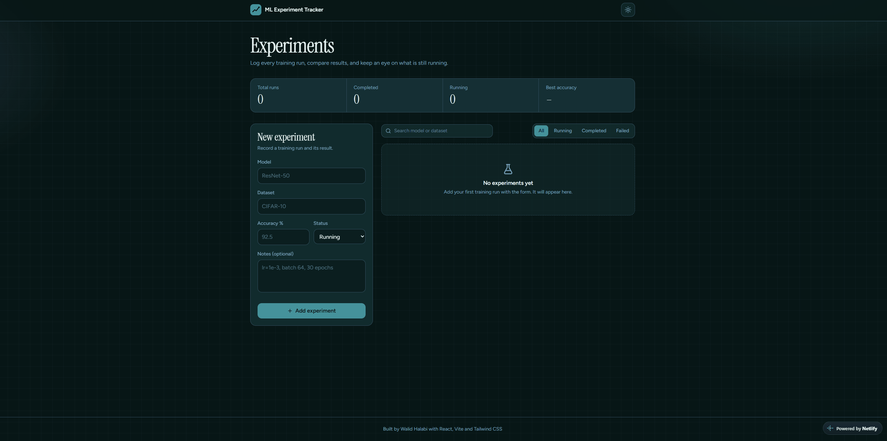
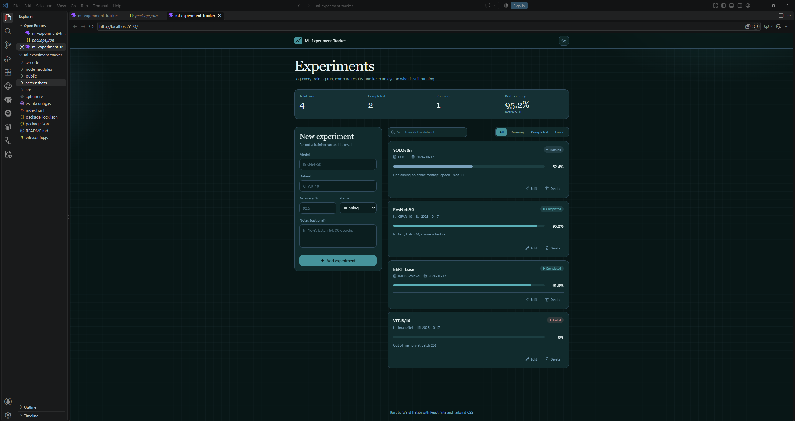
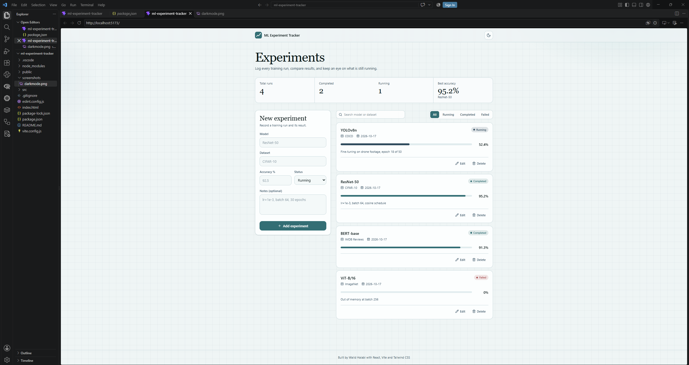

# ML Experiment Tracker

A web app for tracking machine learning experiments: model, dataset, accuracy, status and notes.
Built for the TNC Group "Web Geliştirme; Yapay Zeka" project during my internship at Software Persona.

**Live demo:** https://ml-experiment-tracker-walid.netlify.app


| Dark mode | Light mode |
|---|---|
|  |  |

## Features
- **Add** experiments with model, dataset, accuracy, status and notes
- **List** experiments with color-coded status and an accuracy bar
- **Edit** any experiment in place
- **Delete** with an inline confirmation
- **Search** by model or dataset, and **filter** by status
- **Summary stats**: total runs, completed, running, and best accuracy
- **Dark / light mode** that follows your system and remembers your choice
- Data is saved in the browser with **localStorage**, so it survives page refreshes

## Tech Stack
- [React](https://react.dev/) + [Vite](https://vite.dev/)
- [Tailwind CSS](https://tailwindcss.com/) with theme tokens (CSS variables)
- [Lucide](https://lucide.dev/) icons
- localStorage for persistence
- Deployed on [Netlify](https://www.netlify.com/)

## Project Structure
```
src/
├── components/   # Navbar, StatsBar, Toolbar, ExperimentForm, ExperimentList, ExperimentItem
├── hooks/        # useLocalStorage, useTheme
├── interfaces/   # Experiment data shape, status options and styles
├── pages/        # HomePage (state and CRUD logic)
├── App.jsx       # Layout: navbar, page, footer
└── index.css     # Color tokens for light and dark themes
```

## Run Locally
```bash
npm install
npm run dev
```
Then open http://localhost:5173

## Author
Walid Halabi: [GitHub](https://github.com/WalidMWH)